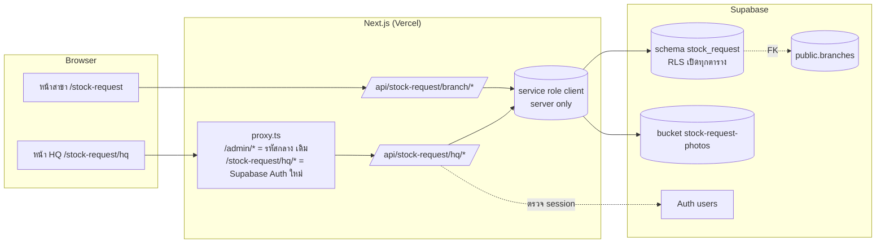
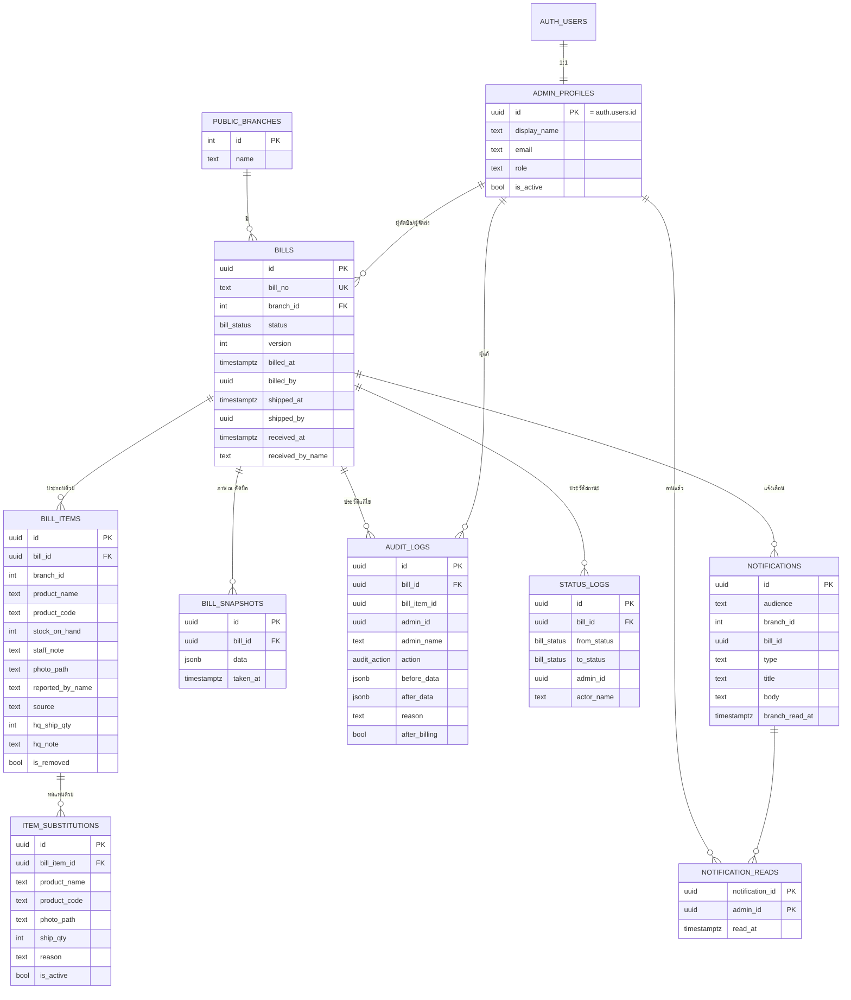
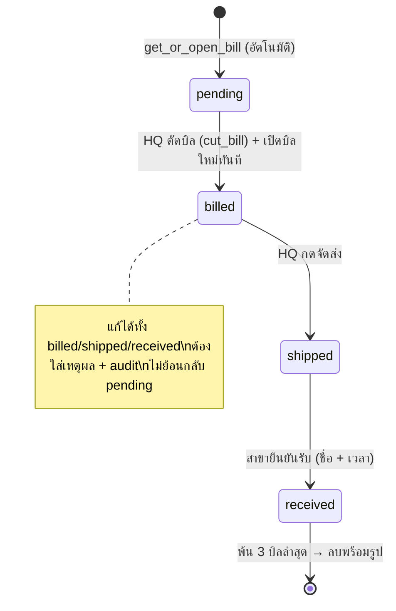

# ระบบแจ้งสินค้าใกล้หมด (Stock Request) — เอกสารออกแบบ Phase 2

> ระบบใหม่ที่อยู่ในโปรเจกต์เดียวกับ "ระบบเบิกสินค้า Aemori" (ของเดิม) และใช้ Supabase project เดียวกัน
> แต่ **แยกข้อมูลออกจากกันชัดเจน** ด้วย Postgres schema ของตัวเองชื่อ `stock_request`

---

## 1. หลักการแยกระบบ

| ส่วน | ระบบเดิม (เบิกสินค้า Aemori) | ระบบใหม่ (แจ้งสินค้าใกล้หมด) |
|---|---|---|
| Database schema | `public` | `stock_request` |
| ตารางสาขา | `public.branches` | ใช้ร่วม (อ่านอย่างเดียว ผ่าน FK) |
| Storage bucket | `product-images` | `stock-request-photos` (private) |
| หน้าสาขา | `/requisition` | `/stock-request` |
| หน้าผู้ดูแล | `/admin/*` (รหัสกลาง) | `/stock-request/hq/*` (บัญชีรายคน Supabase Auth) |
| API | เรียก Supabase จาก browser | `/api/stock-request/*` ฝั่ง server เท่านั้น |

ระบบใหม่ **ไม่เขียน** ตารางใน `public` เลย มีแค่ FK ชี้ไปที่ `public.branches(id)`

### หน้า Main (`/`)
หน้าแรกเปลี่ยนจากหน้า template ของ Next.js เป็นหน้าเลือกระบบ 2 การ์ด

```
┌────────────────────────────┐  ┌────────────────────────────┐
│ ระบบเบิกสินค้า Aemori       │  │ ระบบแจ้งสินค้าใกล้หมด        │
│ เบิกจากรายการสินค้า          │  │ ถ่ายรูปสินค้าที่ใกล้หมด        │
│ [ สาขา ]  [ ผู้ดูแล ]        │  │ [ สาขา ]  [ สำนักงานใหญ่ ]    │
│ /requisition  /admin       │  │ /stock-request  /…/hq      │
└────────────────────────────┘  └────────────────────────────┘
```

---

## 2. Architecture



- **ฝั่งสาขา**: ไม่มี login ตามสเปก เลือกสาขาแล้วเก็บ `branch_id` ใน cookie ทุก request ไป API ฝั่ง server → server ตรวจว่าสาขามีจริง แล้วอ่าน/เขียนเฉพาะข้อมูลของสาขานั้น
- **ฝั่ง HQ**: login ด้วย email/password (Supabase Auth) ทุก API ตรวจ session + ตรวจว่าอยู่ใน `admin_profiles` และ `is_active = true`
- **Service Role Key** อยู่ใน env ฝั่ง server เท่านั้น (`SUPABASE_SERVICE_ROLE_KEY` ไม่มี `NEXT_PUBLIC_`)
- งานที่ต้องเป็น transaction (ตัดบิล, แก้หลังตัด, ลบประวัติ) ทำใน **Postgres function** เรียกผ่าน `rpc`

> ⚠️ ข้อจำกัดที่ต้องรู้: เมื่อไม่มี PIN ใครที่มีลิงก์ก็เลือกเป็นสาขาใดก็ได้ — การแยกข้อมูลสาขาในเวอร์ชันนี้คือ "แยกตามบริบทที่เลือก" ไม่ใช่การยืนยันตัวตน โครงสร้างเตรียมตาราง `branch_members` ไว้สำหรับเพิ่ม login สาขาในอนาคตโดยไม่ต้องรื้อ

---

## 3. โครงสร้างไฟล์ใหม่

```
app/
  page.tsx                                  ← (แก้) หน้า Main เลือกระบบ
  stock-request/
    layout.tsx
    page.tsx                                ← เลือกสาขา + ค้นหา
    staff/page.tsx                          ← ระบุชื่อพนักงาน
    bill/page.tsx                           ← บิลปัจจุบัน + เพิ่มรายการ + กล้อง
    history/page.tsx                        ← 3 บิลล่าสุด + ติดตามสถานะ + ยืนยันรับ
    hq/
      login/page.tsx
      layout.tsx                            ← nav HQ + notification bell
      page.tsx                              ← Dashboard ภาพรวม
      branches/page.tsx                     ← ทุกสาขา + ค้นหา/กรอง
      bills/[billId]/page.tsx               ← ตรวจบิล/แก้รายการ/สินค้าทดแทน
      bills/[billId]/review/page.tsx        ← ตรวจก่อนตัดบิล
      bills/[billId]/print/page.tsx         ← ใบจัดสินค้า A4
      audit/page.tsx                        ← ประวัติการแก้ไข
  api/stock-request/
    branch/…/route.ts
    hq/…/route.ts
components/stock-request/                    ← component แยกย่อย (CameraCapture, BillItemCard, StatusBadge, ConfirmDialog, …)
lib/stock-request/
  supabase-admin.ts                         ← service role client (import 'server-only')
  supabase-server.ts                        ← @supabase/ssr client สำหรับ session HQ
  auth.ts  branch-context.ts  validation.ts  types.ts  storage.ts  export-excel.ts  export-pdf.ts
supabase/migrations/
  2026110300xxxx_stock_request_*.sql
docs/stock-request/
```

**ไฟล์เดิมที่จะแตะ (เท่านั้น)**
| ไฟล์ | การเปลี่ยนแปลง |
|---|---|
| `app/page.tsx` | เปลี่ยนเป็นหน้า Main (เดิมเป็น template ไม่ได้ใช้) |
| `proxy.ts` | **เพิ่ม** เงื่อนไข `/stock-request/hq/*` — logic `/admin/*` เดิมคงไว้ทุกบรรทัด |
| `package.json` | เพิ่ม `@supabase/ssr`, `file-saver`, `server-only`, `@types/file-saver` |
| `app/admin/components/AdminNav.tsx` | (ไม่บังคับ) ปุ่ม "← กลับหน้า Main" |

---

## 4. Database Schema (`stock_request`)

### 4.1 ER Diagram



### 4.2 Enum

```sql
bill_status  : 'pending' | 'billed' | 'shipped' | 'received'
audit_action : 'item_add' | 'item_update' | 'item_remove' | 'item_restore'
             | 'ship_qty_change' | 'substitution_set' | 'substitution_remove'
             | 'note_update' | 'bill_cut' | 'status_change'
admin_role   : 'admin' | 'super_admin'
item_source  : 'branch' | 'hq'
```

### 4.3 รายละเอียดตาราง

**`admin_profiles`** — ผูก 1:1 กับ `auth.users`
| คอลัมน์ | ชนิด | หมายเหตุ |
|---|---|---|
| id | uuid PK | FK → `auth.users(id)` on delete cascade |
| display_name | text not null | ชื่อที่แสดงใน log |
| email | text | |
| role | admin_role default 'admin' | super_admin จัดการ admin อื่นได้ (อนาคต) |
| is_active | bool default true | ปิดบัญชีโดยไม่ลบประวัติ |
| created_at / updated_at | timestamptz | |

**`bills`** — บิลหลักของสาขา
| คอลัมน์ | ชนิด | หมายเหตุ |
|---|---|---|
| id | uuid PK | |
| bill_no | text unique | รูปแบบ `SR-{branch_id 2 หลัก}-{YYMMDD}-{running 3 หลัก}` เช่น `SR-08-261103-001` |
| branch_id | int FK → `public.branches(id)` on delete restrict | |
| status | bill_status default 'pending' | |
| version | int default 1 | เพิ่มทุกครั้งที่ HQ แก้ — กันแก้พร้อมกัน |
| billed_at, billed_by | timestamptz, uuid FK admin | |
| shipped_at, shipped_by | timestamptz, uuid FK admin | |
| received_at, received_by_name | timestamptz, text | พนักงานสาขาผู้ยืนยัน |
| created_at / updated_at | timestamptz | |

ข้อบังคับ:
- `unique (branch_id) where status = 'pending'` → **1 สาขามีบิลเปิดได้ 1 บิลเท่านั้น** (ระดับฐานข้อมูล)
- check: ถ้า status ≥ billed ต้องมี billed_at/billed_by, shipped ต้องมี shipped_at, received ต้องมี received_at

**`bill_items`** — รายการในบิล (แยกจากบิลหลัก)
| คอลัมน์ | ชนิด | หมายเหตุ |
|---|---|---|
| id | uuid PK | |
| bill_id | uuid FK → bills on delete cascade | |
| branch_id | int | ซ้ำกับ bill เพื่อ RLS/query เร็ว (trigger บังคับให้ตรงกับ bill) |
| product_name | text not null (1–200 ตัวอักษร) | พิมพ์เอง |
| product_code | text not null (1–100) | พิมพ์เอง |
| stock_on_hand | int not null ≥ 0 | **คงเหลือหน้าร้าน** ที่สาขาระบุ — HQ แก้ได้เฉพาะผ่าน audit |
| staff_note | text null | หมายเหตุสาขา |
| photo_path | text null | path ใน bucket (สาขาบังคับมี, HQ เพิ่มเองอาจไม่มี) |
| reported_by_name | text not null | ชื่อพนักงาน / ชื่อ admin |
| source | item_source | 'branch' หรือ 'hq' |
| created_by_admin | uuid null | ถ้า HQ เพิ่ม |
| hq_ship_qty | int null ≥ 0 | **จำนวนที่ HQ จะจัดส่ง** — คนละคอลัมน์กับ stock_on_hand |
| hq_note | text null | |
| is_removed / removed_at / removed_by | bool, timestamptz, uuid | ลบแบบ soft เพื่อไม่ให้ข้อมูลเดิมหาย |
| created_at / updated_at | timestamptz | |

**`item_substitutions`** — สินค้าทดแทน (เก็บทุกครั้งที่เปลี่ยน ไม่ลบสินค้าเดิม)
| คอลัมน์ | ชนิด | หมายเหตุ |
|---|---|---|
| id | uuid PK | |
| bill_item_id | uuid FK → bill_items on delete cascade | |
| product_name, product_code | text not null | |
| photo_path | text null | |
| ship_qty | int not null ≥ 0 | |
| reason | text not null | |
| is_active | bool default true | `unique (bill_item_id) where is_active` → ทดแทนที่ใช้งานได้ 1 รายการ เก่าถูกปิดแต่ยังเก็บ |
| created_by | uuid FK admin | |
| created_at, deactivated_at | timestamptz | |

**`bill_snapshots`** — สำเนารายการ ณ เวลาตัดบิล (jsonb ของบิล + items + substitutions) เขียนครั้งเดียว ห้ามแก้

**`audit_logs`** — insert-only (มี trigger ห้าม update/delete ยกเว้นตอนลบบิลทั้งบิลตามกฎ 3 บิล)
| คอลัมน์ | หมายเหตุ |
|---|---|
| bill_id, bill_item_id | |
| admin_id, admin_name | เก็บชื่อ ณ เวลานั้นด้วย เผื่อเปลี่ยนชื่อภายหลัง |
| action | audit_action |
| before_data / after_data | jsonb |
| reason | **บังคับเมื่อ after_billing = true** (check constraint) |
| after_billing | bool — แก้หลังตัดบิลหรือไม่ |
| created_at | |

**`status_logs`** — ทุกครั้งที่สถานะเปลี่ยน (from → to, ใคร, เมื่อไร)

**`notifications`** + **`notification_reads`**
- `audience = 'hq'`: อ่าน/ยังไม่อ่าน แยกรายแอดมินผ่าน `notification_reads`
- `audience = 'branch'`: ผูก `branch_id` ใช้ `branch_read_at` (ไม่มีตัวตนพนักงาน)

**`storage_cleanup_queue`** — path รูปที่ต้องลบจาก Storage หลังลบบิล (ลบ DB ก่อนใน transaction → ลบไฟล์ทีหลัง → ถ้าลบไฟล์พลาดจะลองใหม่ได้ ไม่มีไฟล์ค้างถาวร)

**`branch_members`** (เตรียมไว้ ยังไม่ใช้) — `user_id`, `branch_id` สำหรับ login สาขาในอนาคต

### 4.4 Index
- `bills (branch_id, created_at desc)`, `bills (status, created_at desc)`, `bills (created_at)`
- `bill_items (bill_id) where not is_removed`, `bill_items (branch_id, created_at desc)`, `bill_items (product_code)`
- `item_substitutions (bill_item_id)`
- `audit_logs (bill_id, created_at desc)`, `audit_logs (admin_id, created_at desc)`
- `status_logs (bill_id, changed_at)`
- `notifications (audience, created_at desc)`, `notifications (branch_id, created_at desc) where audience='branch'`
- trigram index บน `public.branches.name` **ไม่ทำ** (19 สาขา ค้นหาฝั่ง client ได้ และไม่แตะตารางเดิม)

---

## 5. Postgres Functions (transaction + lock)

ทุก function: `security definer`, `set search_path = ''`, `revoke execute from public, anon, authenticated` → เรียกได้เฉพาะ service role ผ่าน API

| Function | ทำอะไร |
|---|---|
| `get_or_open_bill(p_branch_id)` | คืนบิล pending ของสาขา ถ้าไม่มีสร้างใหม่ (`insert … on conflict do nothing` + select — ปลอดภัยเมื่อกดพร้อมกัน) |
| `add_branch_item(p_branch_id, p_name, p_code, p_stock, p_note, p_photo_path, p_staff_name)` | `select … for update` บิล pending → insert item → notification HQ "มีรายการใหม่" |
| `hq_add_item / hq_update_item / hq_remove_item(…, p_admin_id, p_expected_version, p_reason)` | ล็อกบิล, เช็ค version, ถ้าบิลไม่ใช่ pending → reason บังคับ, เขียน audit (before/after), version+1 |
| `hq_set_substitution / hq_clear_substitution(…)` | ปิดตัวเก่า (is_active=false) แล้วเพิ่มตัวใหม่ + audit |
| `cut_bill(p_bill_id, p_admin_id, p_expected_version)` | ล็อกบิล → ต้องเป็น pending และ version ตรง → snapshot → status=billed, billed_at/by → status_log → audit → **เปิดบิลใหม่ให้สาขา** → notification สาขา → คืนค่า bill ใหม่ (กดซ้ำ = error "บิลนี้ถูกตัดแล้ว") |
| `mark_shipped(p_bill_id, p_admin_id)` | billed → shipped |
| `confirm_received(p_bill_id, p_branch_id, p_staff_name)` | ตรวจว่าบิลเป็นของสาขานั้น, shipped → received → **เรียก `enforce_history_limit`** |
| `enforce_history_limit(p_branch_id)` | ดูกฎข้อ 7 → ลบบิลเก่า + ส่ง path รูปเข้า `storage_cleanup_queue` |

---

## 6. RLS และสิทธิ์

```sql
-- ทุกตารางใน stock_request
alter table … enable row level security;
revoke all on all tables in schema stock_request from anon;
grant usage on schema stock_request to authenticated, service_role;
```

| Role | สิทธิ์ |
|---|---|
| `anon` | **ไม่มีสิทธิ์เลย** (สาขาเข้าผ่าน API server เท่านั้น) |
| `authenticated` ที่เป็น admin active | `select` ได้ทุกตาราง (policy `stock_request.is_admin()`) — ไว้ใช้ Realtime notification ในอนาคต; **ไม่มี** policy insert/update/delete → การเขียนต้องผ่าน function |
| `authenticated` ทั่วไป | ไม่เห็นอะไร |
| `service_role` | bypass RLS (ใช้ใน API route เท่านั้น) |
| อนาคต: สมาชิกสาขา | policy `branch_id in (select branch_id from branch_members where user_id = auth.uid())` |

**Storage `stock-request-photos`**: private, จำกัด 5 MB, `image/jpeg, image/png, image/webp`
- path: `{branch_id}/{bill_id}/{item_id}.jpg`
- upload: client ขอ **signed upload URL** จาก API (server ตรวจสาขา/บิลก่อน) → อัปโหลดตรงเข้า Storage
- แสดงผล: API คืน signed URL อายุสั้น (เช่น 1 ชม.)
- client ย่อรูปให้ด้านยาว ≤ 1600px, JPEG ~0.8 ก่อนอัปโหลด

**ตั้งค่าที่ต้องทำใน Supabase Dashboard 1 ครั้ง**: Project Settings → Data API → *Exposed schemas* → เพิ่ม `stock_request`
(ปลอดภัยเพราะ anon ไม่มี grant และ RLS ปิดกั้นทุกอย่าง)

---

## 7. Workflow

### 7.1 สถานะบิล



### 7.2 ฝั่งสาขา
1. `/stock-request` เลือกสาขา (ค้นหาได้) → cookie `sr_branch`
2. ครั้งแรก → `/stock-request/staff` กรอก/เลือกชื่อ (จำใน localStorage + cookie, เปลี่ยนได้)
3. `/stock-request/bill` แสดงบิล pending + รายการทั้งหมด
4. กด "เพิ่มสินค้า" → กล้อง (getUserMedia, กล้องหลัง) → ดูตัวอย่าง → ถ่ายใหม่/ยืนยัน
   - ไม่ให้สิทธิ์กล้อง / ไม่มีกล้อง → ปุ่ม "เลือกรูปจากเครื่อง" (`<input type=file accept=image/* capture=environment>`)
5. กรอก ชื่อ, รหัส, คงเหลือ, หมายเหตุ → บันทึก → อัปโหลดรูป → `add_branch_item` (บันทึกทันที)
6. รายการที่บันทึกแล้ว **สาขาแก้/ลบไม่ได้** (ล็อกตั้งแต่บันทึก) — แจ้ง HQ ผ่านหมายเหตุ/ให้ HQ แก้
7. `/stock-request/history` 3 บิลล่าสุด: สถานะ, timeline, รูป, ของเดิม↔ของทดแทน, เหตุผลแก้ไข, ปุ่ม "ยืนยันรับสินค้า" (เฉพาะ shipped) — **ไม่มีปุ่มพิมพ์**

### 7.3 ฝั่ง HQ
1. `/stock-request/hq/login` → Dashboard: จำนวนสาขา, pending, billed, shipped, received, รายการใหม่ล่าสุด, สาขาที่มีรายการเข้า
2. Branches: ค้นหาชื่อ, กรองสถานะ/วันที่, เรียงวันที่สร้าง
3. Bill detail: แก้รายการ, กำหนด `hq_ship_qty`, หมายเหตุ, สินค้าทดแทน (แสดงคู่กัน)
4. Review → ตรวจทุกช่อง → ชื่อผู้ตัดบิลมาจากบัญชีที่ login อัตโนมัติ → Confirm dialog → `cut_bill`
5. Print A4 / Excel / PDF → กดจัดส่ง → รอสาขายืนยัน

### 7.4 แก้หลังตัด / แก้พร้อมกัน
- ทุก request แก้ส่ง `expected_version` → ไม่ตรง = "บิลนี้มีผู้แก้ไขก่อนหน้า กรุณาโหลดใหม่" (ไม่ทับข้อมูลกัน)
- บิล ≠ pending → ช่องเหตุผลบังคับ, audit `after_billing = true`
- ไม่มี function ใดเปลี่ยนสถานะกลับเป็น pending

### 7.5 แจ้งเตือน (ในเว็บเท่านั้น)
| เหตุการณ์ | ผู้รับ |
|---|---|
| รายการใหม่ / บิลรอตัด / สาขายืนยันรับ | HQ |
| ตัดบิล / แก้บิล / จัดส่ง | สาขา |

Bell แสดงจำนวนที่ยังไม่อ่าน, ดึงใหม่ทุก 30 วินาที (Realtime ค่อยเพิ่มภายหลัง)

---

## 8. กฎประวัติ 3 บิล (ต้องยืนยัน)

**ข้อเสนอ (ปลอดภัย)**:
- หน้าประวัติแสดง 3 บิลล่าสุดที่ไม่ใช่ pending
- ลบได้เฉพาะบิลที่ **`received` แล้ว** และอยู่นอก 3 บิลล่าสุด
- บิล pending / billed / shipped **ไม่ถูกลบเด็ดขาด** แม้จะเก่ากว่า (ป้องกันลบบิลที่ของยังไม่ถึงสาขา)
- ลบใน transaction เดียว: snapshot, audit, status_logs, items, substitutions, notifications ของบิลนั้น → path รูปเข้า cleanup queue → API ลบไฟล์ใน Storage แล้ว mark processed

---

## 9. Environment Variables

```env
# มีอยู่แล้ว (ใช้ร่วม)
NEXT_PUBLIC_SUPABASE_URL=
NEXT_PUBLIC_SUPABASE_ANON_KEY=
ADMIN_ACCESS_PASSWORD=        # ระบบเดิมเท่านั้น
ADMIN_SESSION_SECRET=         # ระบบเดิมเท่านั้น

# เพิ่มใหม่
SUPABASE_SERVICE_ROLE_KEY=    # server only — ห้ามใส่ NEXT_PUBLIC_
```

---

## 10. การสร้างบัญชี Admin
1. Supabase Dashboard → Authentication → Add user (email + password)
2. รัน SQL: `insert into stock_request.admin_profiles (id, display_name, email, role) values ('<user id>', 'ชื่อ', 'email', 'super_admin');`
3. หน้าเพิ่ม admin ในเว็บ (สำหรับ super_admin) ทำเป็นงานถัดไปได้
